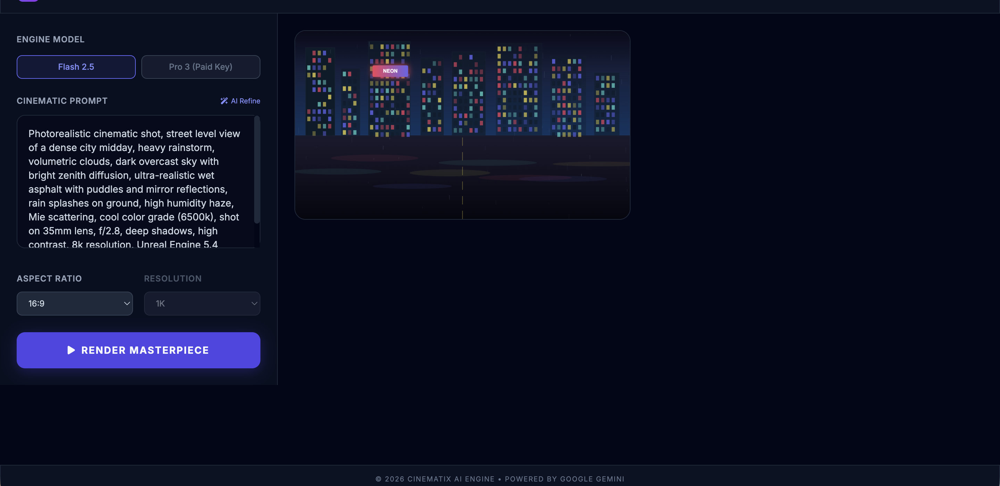
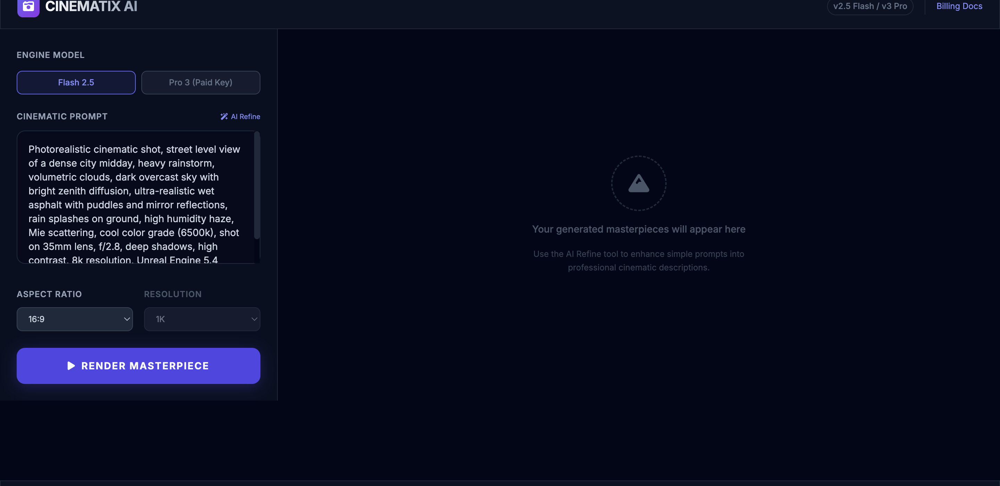

# Cinematix AI

AI-powered cinematic image generation. Write a scene description, optionally let AI refine it into a professional prompt with camera settings and lighting details, then render it through Google Gemini's image generation models.

## Quick Start

```bash
git clone https://github.com/yourusername/cinematix-ai.git
cd cinematix-ai
npm install
npm run dev
```

> Requires Node.js 18+. Set your Gemini API key in `.env.local` before generating images:
> ```
> VITE_GEMINI_API_KEY=your_key_here
> ```

## How It Works

1. **Write a prompt** — describe your scene in the textarea (or start with the included sample)
2. **AI Refine** (optional) — click the wand icon to have Gemini expand your description into a detailed cinematic prompt with lens specs, lighting, and render engine references
3. **Pick your settings** — choose an engine model, aspect ratio, and resolution
4. **Render** — hit the button and Gemini generates the image directly in your browser
5. **Gallery** — generated images appear in the right panel with hover overlays showing metadata, download, and delete

Two Gemini models are supported:

| Model | What it does | Resolution control |
|---|---|---|
| Flash 2.5 | Fast generation, free tier eligible | Fixed |
| Pro 3 | Higher quality, paid key required | 1K / 2K / 4K |

## Screenshots

| Initial state | Gallery with generated image |
|---|---|
|  |  |

## Tech Stack

| Layer | Technology |
|---|---|
| Framework | React 19 |
| Build | Vite 6 |
| Styling | Tailwind CSS 3 |
| AI | Google Gemini (`@google/genai`) |
| Language | TypeScript |
| Icons | Font Awesome 6 |

## Project Structure

```
├── App.tsx              # Main app — state management, UI layout
├── components/
│   └── Layout.tsx       # Shell with header, footer, glassmorphism chrome
├── services/
│   └── geminiService.ts # Gemini API calls (refine + generate)
├── types.ts             # TypeScript enums and interfaces
├── index.html           # Entry HTML with embedded styles
└── .env.local           # API key (not committed)
```

## License

MIT
